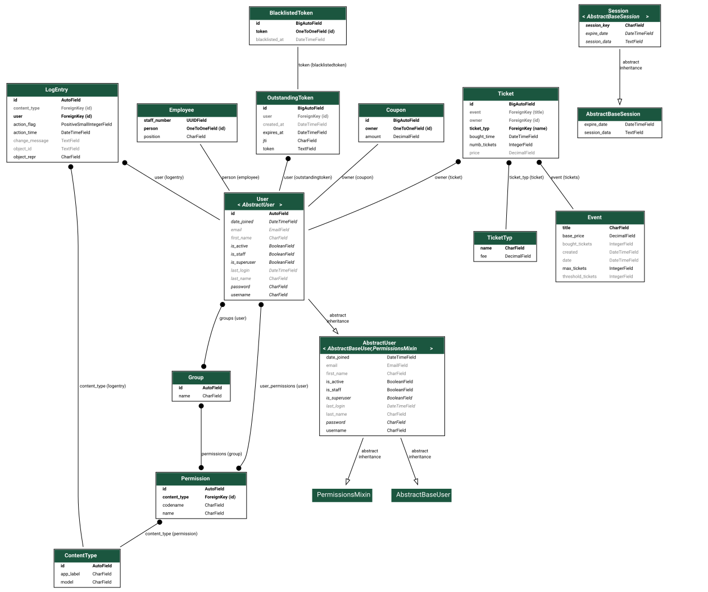
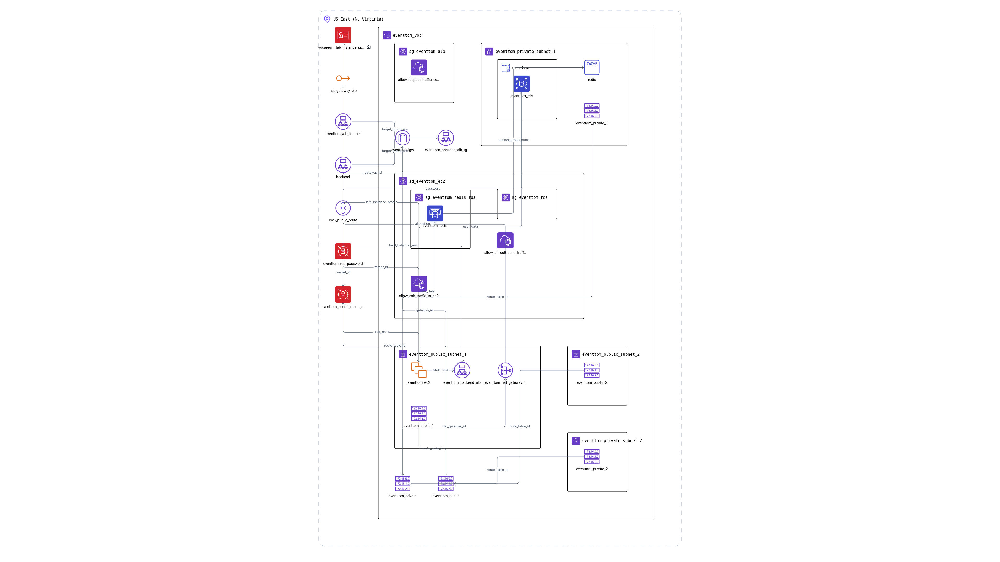

# EvenTom Semesterprojekt Softwarearchitektur und Qualitätssicherung WS 2024/2025

[](https://sonarcloud.io/summary/new_code?id=Flashwar_EventTom)

Dieses Repository stellt das GitHub-Mirror-Repo für das Eventmanagement-Projekt EventTom dar, das nebenbei auf GitLab gehostet wird. Das Projekt wurde im Rahmen des Semesters "Softwarearchitektur und Qualitätssicherung" im Wintersemester 2024/2025 entwickelt.

## Projektbeschreibung

Das Projekt umfasst eine Eventmanagement-Webseite, die es Nutzern ermöglicht, Tickets für verschiedene Events zu kaufen und dabei personalisierte Coupons zu erhalten. Darüber hinaus gibt es unterschiedliche Rollen, die verschiedene Funktionen innerhalb der Webseite haben:

- **Kunde**: Kann ein oder mehrere Tickets kaufen und personalisierte Coupons erhalten.
- **Employee**: Hat bestimmte Berechtigungen für die Verwaltung von Events.
- **EventManager**: Wird benachrichtigt, wenn Tickets für ein Event gekauft wurden.
- **EventCreator**: Kann neue Events erstellen. Sobald ein neues Event erstellt wird, werden alle aktiven Nutzer benachrichtigt.

### Benachrichtigungsfunktionen:
- **EventCreator**: Alle aktiven Nutzer werden benachrichtigt, wenn ein neues Event erstellt wird.
- **Ticketkauf**: Alle aktiven EventManager werden benachrichtigt, wenn Tickets für ein Event gekauft werden, und erhalten die Information, wie viele Tickets für welches Event gekauft wurden.

## Verwendete Technologien

- **Frontend**: Flutter
- **Backend**: Django
- **API**: Restful Framework mit JWT (JSON Web Tokens) für Authentifizierung
- **Websockets**: Für Echtzeit-Kommunikation
- **Datenbank**: PostgreSQL (DBMS)
- **Redis**: Wird für Websockets (Channels) verwendet, um Echtzeit-Benachrichtigungen zu ermöglichen
- **Pattern**: Dependency Injection, Observer, Decorator und Singelton

## Model Schema und Cloud Infrastructure

### Model Schema

### Cloud Infrastructure



## Installation

### Repository klonen und .env-Datei erstellen
Zuerst das Repository klonen und in das Projektverzeichnis wechseln:
```bash
mkdir eventtom
cd eventtom
git clone https://github.com/Flashwar/EventTom.git .
```

Erstelle dann die `.env`-Datei und konfiguriere sie:
```plaintext
SECRET_KEY=<Django-Secret-Key>
DATABASE_URL=''
WEBSITE_HOSTNAME='127.0.0.1'
REDIS_SERVERIP='127.0.0.1'
```
**Hinweis**: Den Django-Secret-Key kannst du [hier generieren](https://djecrety.ir/).

---

### Backend-Setup

#### **Mit Poetry**
1. **Poetry installieren**:
   ```bash
   curl -sSL https://install.python-poetry.org | python3 -
   ```
   Weitere Details findest du in der [offiziellen Dokumentation](https://python-poetry.org/docs/#installation).

2. **Abhängigkeiten installieren**:
   ```bash
   poetry install
   ```

3. **Projektumgebung aktivieren**:
   ```bash
   eval $(poetry env activate)
   ```

4. **Django-Server starten**:
   ```bash
   python manage.py runserver
   ```
   Der Server ist unter `http://127.0.0.1:8000` erreichbar.

---

#### **Mit virtueller Umgebung (venv)**
1. **Virtuelle Umgebung erstellen und aktivieren**:
   ```bash
   python -m venv venv
   source venv/bin/activate   # Windows: venv\Scripts\activate
   ```

2. **Abhängigkeiten installieren**:
   ```bash
   pip install -r requirements.txt
   ```

3. **Alternative Einstellungen (SQLite, In-Memory-Channels)**:
   Falls PostgreSQL oder Redis nicht verwendet werden soll, können folgende Anpassungen in `settings.py` vorgenommen werden:
   ```python
   CHANNEL_LAYERS = {
       "default": {
           "BACKEND": "channels.layers.InMemoryChannelLayer"
       }
   }

   DATABASES = {
       'default': {
           'ENGINE': 'django.db.backends.sqlite3',
           'NAME': BASE_DIR / "db.sqlite3",
       }
   }
   ```

4. **Django-Server starten**:
   ```bash
   python manage.py runserver
   ```
   Der Server ist unter `http://127.0.0.1:8000` erreichbar.

---

## Testen des Projekts

### Tests ausführen

#### **Mit Poetry**
1. Poetry-Umgebung aktivieren:
   ```bash
   eval $(poetry env activate)
   ```
2. Tests starten:
   ```bash
   python manage.py makemigrations
   python manage.py test backend.tests
   ```

#### **Mit venv**
1. Virtuelle Umgebung aktivieren:
   ```bash
   source venv/bin/activate   # Windows: venv\Scripts\activate
   ```
2. Tests starten:
   ```bash
   python manage.py makemigrations
   python manage.py test backend.tests
   ```

---

## Installation in einem Docker-Container

EvenTom unterstützt Docker-basierte Deployments. Führe folgenden Befehl aus:
```bash
docker-compose up --build
```
Dabei werden drei Container gestartet:
1. **Redis**: Für Echtzeit-Kommunikation
2. **PostgreSQL**: Für Datenbankverwaltung
3. **Backend**: Für die API und Geschäftslogik

Das Backend ist unter `http://127.0.0.1:8000` erreichbar.

### **Tests in Docker ausführen**

1. **Container-ID ermitteln**:
   ```bash
   docker ps
   ```
   Der Befehl zeigt eine Liste aller laufenden Container. Notiere die Container-ID des Backend-Containers.

2. **Mit dem Container verbinden**:
   ```bash
   docker exec -it <containerid> sh
   ```

3. **Tests ausführen**:
   ```bash
   python manage.py makemigrations
   python manage.py test backend.tests
   ```